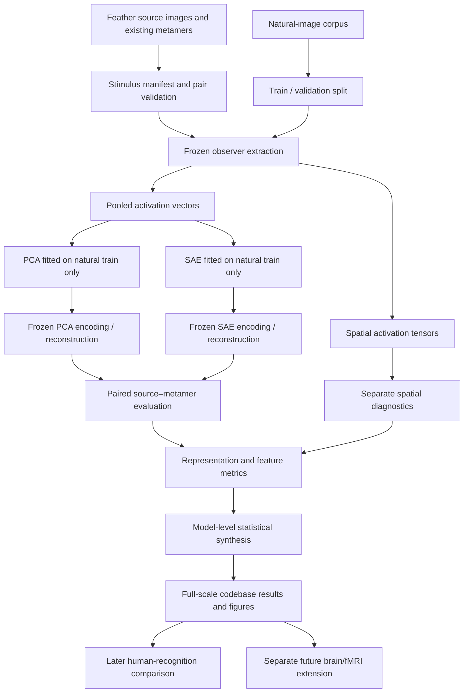

# METAMER-SAE
# Full-Scale Research and Codebase Build Guide

**Document type:** Master scientific, methodological, implementation and agent handover guide  
**Project/repository:** `metamer-sae`  
**Original proposal:** *Why Model Metamers Appear Wrong from Their Feature Representation Maps*  
**Consolidated status:** Colab prototype Notebooks 01–09 completed computationally; next milestone is the full research codebase  
**Date:** 19 November 2026

---

# 0. Read this first: instructions to any future agent

You are joining an existing research project. Do not treat this document as a greenfield proposal, and do not restart completed experiments.

**The nine-notebook Colab workflow is the validated prototype. The full `metamer-sae` repository is the scalable research implementation.** The notebooks validate each stage on a manageable subset. The repository must turn the validated stages into reusable, testable and configurable software and then scale the same scientific pipeline to the broader eligible Feather stimulus/model/layer inventory.

## 0.1 Non-negotiable rules

1. Do not overwrite or retrain existing pilot checkpoints. Treat the existing PCA/SAE artifacts as immutable reference artifacts.
2. Do not alter the fixed pilot split: 8 development / 32 primary / 8 reserve triplets.
3. Do not train PCA or SAE on Feather source images or metamers. Fit representations on natural-image training activations only.
4. Do not fit separate PCA/SAE representations for standard and adversarial conditions merely to make them comparable. The pilot uses shared frozen representations.
5. Keep generator, observer and recognition-model roles separate.
6. Keep pooled and spatial representations separate. The pooled 384-D SAE is not a spatial SAE.
7. Do not equate SAE feature indices across random seeds. Use explicit feature matching and report matching quality.
8. Do not call decoder features semantic concepts or causal units merely because they activate.
9. Do not infer human recognisability from Notebooks 07–09. They measure model representations, not human judgements.
10. Do not access human behavioural data in the model-only pipeline. Human-recognition analysis is a later, separately initiated stage.
11. Do not access the eight reserve activation rows during the current pilot.
12. Do not silently change preprocessing, model weights, layers, data partitions, package versions or metric definitions.
13. Do not declare a stage complete merely because cells execute. Inspect outputs and verify saved artifacts.
14. Preserve the original proposal's motivation. Feature-pattern analysis supports the research question; it does not replace it.
15. Do not claim the full project is complete because the Colab prototype completed.

## 0.2 How to use this guide

Read Sections 1–8 to understand the project and completed notebooks. Read Sections 9–17 for the full repository architecture and implementation phases. Read Sections 18–25 before running experiments. Read the final sections for acceptance criteria and handover instructions.

Unsettled choices are marked **OPEN DECISION** or **PROPOSED**. Verify them against the actual Feather metadata, repository, dataset and installed package rather than inventing answers.

---

# 1. Project identity and scientific motivation

## 1.1 Identity and inspiration

**Project:** Metamer-SAE  
**Repository:** `metamer-sae`  
**Original proposal title:** *Why Model Metamers Appear Wrong from Their Feature Representation Maps*

The project is inspired by:

- Feather, Leclerc, Mądry and McDermott (2023), *Model metamers reveal divergent invariances between biological and artificial neural networks*, Nature Neuroscience.
- Feather's `model_metamers_pytorch` repository, which supplies pretrained generator models, model configurations, metamer generation code, source/metamer stimuli and released behavioural measurements.
- Sparse dictionary learning and sparse autoencoders (SAEs) as a way to decompose model activations into a larger set of sparse latent features.
- Principal Component Analysis (PCA) as a linear representation baseline.

Core resources:

- Feather paper: https://www.nature.com/articles/s41593-023-01442-0
- Feather repository: https://github.com/jenellefeather/model_metamers_pytorch
- Overcomplete repository: https://github.com/KempnerInstitute/overcomplete
- Overcomplete docs: https://kempnerinstitute.github.io/overcomplete/
- Conwell et al. / DeepNSD background: https://www.nature.com/articles/s41467-024-53147-y and https://github.com/ColinConwell/DeepNSD/
- Natural Scenes Dataset: https://naturalscenesdataset.org/

The Feather repository commit used and recorded in the early audit was:

`d9629b58ad43ce9a6bd74be951869cffbd8e8161`

Preserve the commit hash and exact Feather files/checkpoints used in every run. Do not assume the current upstream default branch is equivalent to the audited commit.

## 1.2 Why this project exists

A model metamer is an image synthesised to match a selected internal representation of a natural source image in a fixed neural network. The generator network's weights remain fixed while the image is optimised so that its activation at a selected layer approaches the source activation.

Let \(x\) be a natural source photograph, \(x'\) its metamer, and \(f_{\theta,l}\) the activation function of a generator network with fixed parameters \(\theta\) at layer \(l\). Metamer generation seeks:

\[
f_{\theta,l}(x') \approx f_{\theta,l}(x)
\]

The pixels can change substantially even when the selected generator representation is closely matched. An image can therefore be equivalent to its source from the viewpoint of one model layer, yet not preserve the visual information humans use to recognise the source.

Feather et al. investigated how model training conditions affect the recognisability of visual metamers. Metamer-SAE asks what changes in internal visual representations accompany those differences, and whether sparse features learned from natural-image activations provide a useful description of source-to-metamer differences beyond raw channel activations or PCA.

## 1.3 Primary motivation and research questions

The original proposal's central question is:

> **Which features make a model blind to what we see?**

The proposal also asks whether network layers and brain regions process features in related ways. The first question is the primary focus. Brain alignment is a future extension, not part of the current model-only pipeline.

Formal questions in the comprehensive project plan:

- **RQ1 — Feature-space structure:** Do SAE feature representations reveal source-image versus metamer differences that are less visible or differently structured in the original neuron/channel activation space?
- **RQ2 — Generator training condition:** Do these differences vary between standard-trained and adversarially trained visual networks?
- **RQ3 — SAE versus PCA:** How do SAE representations compare with PCA in natural-image reconstruction, sparsity, feature stability and metamer discrimination?
- **RQ4 — Human recognition:** Do feature-level measures of metamer difference relate to human recognition accuracy across model stages, models or stimulus conditions?
- **RQ5 — Observer agreement:** Do different observer networks agree on which model metamers remain recognisable, and how does this relate to the generator model's representation?
- **RQ6 — Brain extension:** Do model-layer or SAE feature geometries align with visual-cortex response geometries measured using existing public fMRI data?

RQ1–RQ3 define the model-representation work. RQ4–RQ5 define a later behavioural and observer-comparison stage. RQ6 is a separate future extension.

## 1.4 Working hypotheses

These are hypotheses to test, not results to assume:

- **H1 — Feature-space structure:** SAE latent representations will expose structured source–metamer differences that are not identical to PCA projections.
- **H2 — Training-condition differences:** Standard and adversarially trained networks may yield different feature-level metamer signatures.
- **H3 — Behavioural relationship:** Some feature-level measures may covary with human recognition, but direction and strength must be established empirically.
- **H4 — Layer dependence:** Metamer differences and human recognisability may vary with generator layer.
- **H5 — Brain extension:** Model and SAE representations may show different degrees of alignment with brain response geometry.

The current model-only prototype provides evidence relevant to H1 and H2 in one restricted generator/observer configuration. It does not test H3–H5.

---

# 2. The project proposal and the prototype: preserve the distinction

The original proposal is the scientific compass. The completed Colab notebooks are a deliberately narrow prototype.

## 2.1 What the original proposal intended

The original proposal describes a pipeline in which:

1. Feather source photographs and existing metamers are passed through a separate pretrained observer network.
2. Observer activations are extracted at a layer distinct from the generator model/layer that created the metamers.
3. PCA and an SAE are trained on natural-image activations.
4. Source and metamer activations are encoded/reconstructed with these frozen representations.
5. Metamer scores are compared with source scores.
6. Scores are aggregated by model/layer/generator condition.
7. In a later behavioural stage, representation-level scores are compared with existing Feather human-recognition measurements.
8. Scores are benchmarked against PCA, pixel distance, SSIM, LPIPS, other recognition models and layer depth.

The proposal explicitly avoids new human testing and intends to use Feather's pre-existing anonymised behavioural data.

## 2.2 Original proposal condition choices

The original proposal's initial implementation sketch discussed an AlexNet experiment with standard, adversarially trained \(L_2,\epsilon=3\), and noise-control conditions, with IPCL/self-supervised experiments as a possible extension. It also discussed a separate observer layer below the matched generator layer and a comparison at fixed layer depth.

That was the proposal-stage design, not the configuration ultimately used in the Colab pilot.

## 2.3 What the completed Colab prototype implemented

The prototype narrowed the generator comparison to a matched ResNet-50 standard/adversarial pair:

| Role | Pilot choice |
|---|---|
| Standard generator | Feather `experiment_1`, `resnet50` |
| Adversarial generator | Feather `experiment_3`, `resnet50_l2_3_robust` |
| Generator layer | `layer2_fake_relu` |
| Generator layer index in Feather metadata | `2` |
| Common observer | TorchVision ConvNeXt-Tiny, ImageNet-1K pretrained |
| Observer feature stage | Stage 3 |
| Observer spatial activation | 384 channels × 14 × 14 |
| Observer pooled activation | 384-D vector |
| PCA | Frozen pooled PCA, 16-D working baseline, 64-D sensitivity view |
| SAE | Overcomplete TopK, 4× dictionary, K=64 |
| SAE seeds | 123 primary, 42 replicate |

The prototype did not include the original proposal's noise-control generator condition, AlexNet generator experiment, IPCL extension, full model/layer matrix or human-behaviour analysis.

**This is a controlled prototype decision, not a replacement of the proposal.** The full codebase must not hard-code the ResNet-50 pilot as the only generator family.

## 2.4 Three distinct model roles

### Generator model
The network whose internal activation was matched when the image was generated. In the pilot, this is a standard or adversarial ResNet-50.

### Common observer
A separate model used to process every source and metamer in one common activation space. In the pilot, this is ConvNeXt-Tiny Stage 3.

### Recognition baseline model
A model used to measure whether an image can be categorised correctly or to compare model-recognition behaviour with human judgements. The proposal mentions AlexNet, ResNet, IPCL and other pretrained recognition models.

Do not use these labels interchangeably. A generator model is not automatically the observer. A pooled SAE is not a classifier. A recognition model's top-1 accuracy is not the same outcome as an observer activation distance.

## 2.5 Observer layer and generator layer are not interchangeable

The pilot generator layer is a Feather ResNet-50 layer identifier, `layer2_fake_relu`. The observer layer is ConvNeXt-Tiny Stage 3. They belong to different architectures and have different representational hierarchies.

For the full project, record the generator architecture/layer and observer architecture/layer independently. Do not call them “the same depth” merely because both have an ordinal stage number. If depth control is required for behavioural modelling, define a justified depth variable for each generator architecture and test sensitivity to that definition.

---

# 3. Complete experimental architecture

## 3.1 Scientific data flow



## 3.2 Primary data-flow rule

**Train representations on natural images. Evaluate them on held-out source/metamer pairs.**

- Imagenette or another declared natural-image corpus provides the fitting distribution.
- PCA is fitted on natural-image training activations only.
- SAE dictionaries are trained on natural-image training activations only.
- Validation images are used for quality assessment and model selection.
- Feather sources and metamers are transformed by frozen models.
- The same frozen observer/PCA/SAE is applied to all three conditions within a matched stimulus group.
- Feather test stimuli must not be used to fit PCA, train the SAE or choose representation hyperparameters.

## 3.3 Two complementary analysis strands

**Strand A — Primary representation comparison**

- Compare source with paired standard metamer.
- Compare source with paired adversarial metamer.
- Compute raw observer-space differences.
- Compute PCA-space differences.
- Compute SAE-code differences.
- Compare reconstruction residuals.
- Compare sparse support overlap.
- Compare feature-wise changes.
- Compare generator/model/layer conditions where available.
- Estimate paired effects and uncertainty at the correct sampling unit.

**Strand B — Supporting feature-pattern and interpretability analysis**

- Feature activation distributions.
- Feature density and dead-feature rates.
- Activation mass concentration.
- Top-activating natural-image galleries.
- Feature-response comparisons across source/standard/adversarial conditions.
- Feature correlations and redundancy diagnostics.
- Decoder direction comparisons.
- Cross-seed feature matching and stability.
- Spatial feature maps only when the model and analysis preserve spatial coordinates.

Strand B supports Strand A. It does not replace the original scientific question or independently establish semantic meaning.

---

# 4. Data sources, stimuli and fixed pilot allocation

## 4.1 Feather data

Use Feather's public repository for model metadata, checkpoints, source images, existing metamers, generation code and behavioural data reserved for the later behavioural stage.

The pilot reused already-generated stimuli. It did not regenerate the whole metamer collection.

Do not run Feather's broad `download_large_files.py` blindly. The project handover warns that it can download visual and audio assets beyond the current visual need. Inventory precisely what is needed and verify every file.

## 4.2 Natural-image data

The pilot used Imagenette-320:

| Split | Images | Pooled activation shape |
|---|---:|---|
| Train | 9,469 | 9,469 × 384 |
| Validation | 3,925 | 3,925 × 384 |

The full codebase should support dataset configuration, but any expansion beyond Imagenette is a new documented representation-learning run, with its own dataset version, split, sample metadata and hashes. Do not silently replace the Imagenette-derived pilot models.

## 4.3 Feather availability scan

The pilot checked image indices `0–399` for the selected standard/adversarial ResNet-50 conditions:

| Item | Count |
|---|---:|
| Candidate IDs checked | 400 |
| Accessible source images | 400 |
| Accessible standard metamers | 397 |
| Accessible adversarial metamers | 400 |
| Complete source + standard + adversarial triplets | 397 |

Three candidate indices lacked a standard metamer and were excluded:

- `207`
- `240`
- `336`

The 48 pilot triplets were sampled from the complete pool. **Full-scale availability must be enumerated separately for every model/layer/condition.** Do not assume all 400 source photographs have a complete metamer for every generator.

## 4.4 Fixed pilot split

Seed: `42`

| Split | Triplets | Images across three conditions |
|---|---:|---:|
| Development | 8 | 24 |
| Primary evaluation | 32 | 96 |
| Reserve | 8 | 24 |
| **Total** | **48** | **144** |

Development IDs:

```text
[0, 260, 308, 84, 199, 119, 97, 27]
```

Primary IDs:

```text
[116, 101, 133, 125, 232, 362, 227, 326,
 398, 358, 54, 78, 288, 45, 295, 249,
 329, 197, 108, 393, 234, 59, 205, 245,
 102, 343, 52, 241, 286, 81, 383, 361]
```

Reserve IDs:

```text
[46, 255, 186, 169, 395, 134, 194, 62]
```

The split is fixed. Do not resample it or use primary/reserve stimuli for feature/dictionary selection. Index `0` was retained in development because it had already been previewed in the initial audit.

No category stratification was performed in this pilot because the candidate inventory did not provide a usable category field for the sampling step. The full codebase should use categories where reliable metadata exists and document whether a split is stratified.

## 4.5 Full-scale stimulus coverage

The full codebase should support all eligible complete Feather source/metamer groups across multiple generator networks, training conditions, experiments and layers. It must support missing stimuli and incomplete pairs.

Do not define the full study as “400 triplets everywhere.” The repository audit found multiple visual model configurations, and the proposal describes roughly 40 model/layer conditions, but availability varies. The authoritative count must come from the pinned Feather metadata plus verified image/checkpoint availability.

The full-scale system must use a manifest as the source of truth and produce per-condition availability reports. Complete paired groups should be retained for a paired contrast; incomplete groups remain in an availability table, not silently dropped.

## 4.6 Full-scale split policy

The pilot's 8/32/8 split is immutable for pilot reproduction.

For expanded experiments:

1. Define the eligible source-image universe for each planned condition family.
2. Split by **source identity**, not individual file. Every source and all its standard/adversarial/control metamers remain in the same partition.
3. Where conditions share a source, use a shared source-level allocation across conditions.
4. Stratify by category only if reliable metadata is present.
5. Decide sample counts and seed before evaluating test metrics.
6. Store the split manifest and SHA-256 hash.
7. Keep representation fitting separate from all Feather splits.

Do not invent percentages now. The full-scale split design is an open decision requiring the actual number of complete source groups, category coverage and intended confirmatory analysis.

---

# 5. Feather repository audit and stimulus metadata

## 5.1 Notebook 01 findings

Notebook 01 (`01_environment_and_repository_audit_REVIEWED.ipynb`) audited the Feather repository, environment and visual assets.

Recorded commit: `d9629b58ad43ce9a6bd74be951869cffbd8e8161`

The audit identified nine visual experiment groupings and thirty visual model configurations in the audited catalogue. It inventoried candidate visual checkpoints/assets and identified the standard ResNet-50 and adversarial ResNet-50 condition keys.

The initial environment history included Python 3.13.18 and a CPU-only PyTorch runtime. That was not the final SAE training environment.

The initial audit intentionally did not download all Feather weights/assets, generate new metamers at scale, load human-recognition data, access audio data or train an SAE.

## 5.2 Selected pilot metadata

| Condition | Feather experiment key | Network key | Layer |
|---|---|---|---|
| Standard | `experiment_1` | `resnet50` | `layer2_fake_relu` |
| Adversarial | `experiment_3` | `resnet50_l2_3_robust` | `layer2_fake_relu` |

The handover records both selected conditions at layer index `2`. Do not infer a paper experiment number from the repository key; read actual metadata.

## 5.3 Required full-system manifest

At minimum, a stimulus record should contain:

```text
stimulus_id
source_image_id
category_id                  # nullable if unavailable
category_name                # nullable
feather_commit
feather_experiment_key
generator_condition
generator_model_key
generator_architecture
generator_checkpoint_id
generator_checkpoint_hash
generator_layer_key
generator_layer_index
stimulus_role                 # source / standard / adversarial / control
image_path
image_sha256
image_width
image_height
image_format
availability_status
retrieval_timestamp
retrieval_source
```

A pair/triplet manifest should contain:

```text
pair_id
source_image_id
experiment_family
generator_layer
source_stimulus_id
standard_stimulus_id
adversarial_stimulus_id
control_stimulus_id           # nullable
split
pair_complete
exclusion_reason
```

Use stable IDs, not row positions. Never join by file ordering.

## 5.4 Download and validation procedure

1. Resolve the correct URL/path from Feather metadata/helper code.
2. Check availability.
3. Download to a temporary file.
4. Verify completion and file size.
5. Decode the image with a strict reader.
6. Record dimensions and format.
7. Compute SHA-256.
8. Move the valid file to its canonical path.
9. Record success/failure and retry information.
10. Verify pairing before accepting the record.

Do not fabricate URLs, assume all IDs exist or silently replace corrupt files with unrelated images.

---

# 6. Notebook 03: common observer and activation extraction

## 6.1 Why an independent common observer is used

The generator networks differ across conditions. A separate common observer provides one consistent feature extractor for all source/metamer stimuli.

The observer is not the generator, and its activation difference is not a human perceptual measure.

## 6.2 Pilot observer configuration

- Architecture: ConvNeXt-Tiny.
- Weights: TorchVision ImageNet-1K pretrained (`ConvNeXt_Tiny_Weights.IMAGENET1K_V1`).
- Input: 224 × 224 RGB.
- Observer stage: Stage 3.
- Parameters: all frozen.
- Spatial output: 384 × 14 × 14.
- Pooled output: 384-D vector.

Recorded official TorchVision preprocessing:

- Resize to 236.
- Center crop to 224 × 224.
- Bilinear interpolation.
- Mean `[0.485, 0.456, 0.406]`.
- Standard deviation `[0.229, 0.224, 0.225]`.

Use the exact saved preprocessing config. Do not replace it with a generic resize/normalisation sequence.

## 6.3 Activation extraction

For each image preserve:

**Spatial activation:** \(A \in \mathbb{R}^{384\times14\times14}\)

**Global-average-pooled activation:**

\[
a_c = \frac{1}{H W}\sum_{h=1}^{H}\sum_{w=1}^{W}A_{c,h,w}
\quad\in\mathbb{R}^{384}
\]

The pooled activation is the input to the current PCA and SAE pipeline. The spatial tensor is retained for separate diagnostics.

Do not reshape pooled vectors into spatial maps or claim a pooled SAE feature has a 14 × 14 location.

## 6.4 Completed activation extraction

Notebook 03 extracted 13,538 images:

| Data source | Samples |
|---|---:|
| Imagenette train | 9,469 |
| Imagenette validation | 3,925 |
| Feather source | 48 |
| Feather standard | 48 |
| Feather adversarial | 48 |
| **Total** | **13,538** |

Spatial tensors were float16; pooled vectors float32. All five groups passed reported integrity checks for shapes, data types, finite values, metadata counts, extraction progress, source/metamer identity correspondence and split alignment.

Key outputs:

```text
activations/
├── natural_images/
│   ├── train/
│   │   ├── spatial_activations.npy
│   │   ├── pooled_activations.npy
│   │   └── metadata.csv
│   └── validation/
│       ├── spatial_activations.npy
│       ├── pooled_activations.npy
│       └── metadata.csv
├── feather/
│   ├── source/
│   ├── standard_resnet50/
│   └── adversarial_resnet50/
├── audit/
│   ├── comprehensive_activation_integrity_audit.json
│   └── notebook_03_closure_report.json
└── visualizations/
    ├── figure_7_1_spatial_activation_maps.png
    ├── figure_7_2_pooled_activation_distributions.png
    ├── figure_7_3_source_metamer_similarity.png
    └── figure_7_3_similarity_values.csv
```

Preliminary development cosine similarities: source–standard approximately `0.9995`; source–adversarial approximately `0.9997`. These show high pooled directional alignment, not equality or human equivalence.

## 6.5 Full-scale extraction requirements

Support batch extraction, resume, configurable observer/checkpoint/layer, spatial+pooled outputs, stable IDs, metadata/transformation hashes, exact cache keys, finite/shape assertions, completion logs and memory-efficient array storage.

A cache key should include image checksum, observer/checkpoint hash, layer, preprocessing hash, pooling method and extraction-code version.

---

# 7. Notebook 04: pooled PCA baseline and visualization extension

## 7.1 PCA's role

PCA is the linear representation baseline. The full system uses one shared PCA fitted on natural-image training activations for the conditions being compared. Do not fit separate PCAs for source, standard and adversarial images.

## 7.2 Pilot PCA run

Run ID: `pca_20261119T065920Z`

- Fit samples: 9,469 Imagenette training pooled activations.
- Shape: `(9469, 384)`.
- 384 components fitted.
- scikit-learn `PCA(n_components=384, svd_solver='full', whiten=False)`.
- Mean-centering only.
- No per-channel standardisation.
- No whitening.

### Component decision

PCA-16 is the working baseline.

| Retained components | Cumulative variance | Validation MSE |
|---:|---:|---:|
| 1 | 93.04% | 0.00652487 |
| 2 | 93.56% | 0.00601390 |
| 4 | 94.23% | 0.00539995 |
| 8 | 95.10% | 0.00458574 |
| **16** | **96.0058%** | **0.00374890** |
| 24 | 96.51% | 0.00328695 |
| 32 | 96.88% | 0.00294813 |
| 48 | 97.42% | 0.00245033 |
| **64** | **97.82%** | **0.00208057** |
| 96 | 98.41% | 0.00154061 |
| 128 | 98.83% | 0.00115273 |
| 160 | 99.15% | 0.00085454 |
| 192 | 99.39% | 0.00061822 |
| 256 | 99.73% | 0.00028586 |
| 320 | 99.92% | 0.00008745 |
| 384 | 100.00% | approximately 0 |

PCA-16 was selected for parsimony: 16 of 384 dimensions (about 4.17%) retain about 96.01% training variance. PCA-64 is a sensitivity analysis, not an exact capacity match to the SAE.

## 7.3 Channel-scale diagnostic

Recorded training channel SD statistics:

- Median: `0.07589`.
- Maximum: `5.76752`.
- Maximum is about 76× median.
- PC1 explains about 93.04% of variance.

This may mean activation magnitude or a few high-scale channels dominate PC1. It is not automatically an error. Any standardised-PCA experiment must be separately named and fit scaling on natural train only. Do not replace the frozen PCA-16 basis.

## 7.4 Development-only PCA result

For eight development triplets, PCA-16 source-to-metamer L2:

| Metric | Standard | Adversarial |
|---|---:|---:|
| Mean | 3.59386 | 1.82734 |
| SD | 1.78518 | 0.91869 |
| Median | 3.56689 | 2.02911 |
| Minimum | 1.19770 | 0.49724 |
| Maximum | 7.19674 | 3.06009 |

Exploratory only; primary/reserve stimuli were not used for fit or component selection.

## 7.5 Notebook 04B visualization extension

`04_pca_visualization_extension.ipynb` loaded the saved pooled PCA and added descriptive visualisations without refitting it:

- Activation-vector reconstruction heatmaps.
- Representational similarity matrices.
- 3-D PCA projection with paired triplet trajectories.
- PCA channel-correlation circle.
- PC1 versus activation-magnitude diagnostics.
- A separate spatial PCA experiment.

**Spatial PCA is a distinct representation.** It treats spatial positions from Imagenette training maps as observations and keeps position for 14 × 14 maps. The handover records an IncrementalPCA with eight components on natural training spatial positions. Do not present this as the pooled 384-D PCA. Verify all user-reported extension artifacts in Drive before treating every output as independently audited.

## 7.6 Full-scale PCA requirements

- Fit one saved basis per declared observer/layer/natural-training configuration.
- Store the full basis and component-retention table.
- Record centering, scaling, whitening and solver.
- Transform all evaluation conditions with the same basis.
- Keep pooled PCA and spatial PCA separate.
- Never refit merely because a new figure is needed.
- Preserve the pilot PCA run as immutable reference.

---

# 8. Notebook 05: Overcomplete environment and SAE preparation

## 8.1 Overcomplete

The project selected Kempner Institute **Overcomplete** rather than implementing the initial SAE architecture from scratch. The project should wrap this dependency behind a stable API so evaluation code is not coupled to third-party internals.

Potential variants include Vanilla, TopK, BatchTopK and JumpReLU. The prototype trained TopK only. Future variants must be separately configured and evaluated.

## 8.2 Validated pilot environment

| Component | Validated pilot version |
|---|---|
| Python | 3.12.13 |
| PyTorch | 2.11.0 + CUDA 12.8 (`2.11.0+cu128`) |
| TorchVision | 0.26.0 + CUDA 12.8 |
| GPU | Tesla T4 |
| Overcomplete | 0.3.0 |

Overcomplete 0.3.0 requires Python `<3.13`.

Working import:

```python
from overcomplete.sae import TopKSAE, train_sae
```

Do not use `from overcomplete.models import TopKSAE`.

These are historical validated pilot versions, not a claim that they are newest. Pin the environment and verify compatibility in a clean runtime.

## 8.3 SAE input preparation

Notebook 05 loaded:

- Train `(9469, 384)`, float32.
- Validation `(3925, 384)`, float32.

It fitted a single activation mean on Imagenette train:

\[
x_{\mathrm{SAE}}=x-\mu_{\mathrm{train}}
\]

The exact saved mean was applied unchanged to validation and later Feather activations.

There is no per-channel standardisation, variance scaling or whitening. No new centring is estimated from Feather data.

Saved artifacts:

```text
outputs/sae_preparation/
├── training_activation_mean.npy
├── train_centered_activations.npy
├── validation_centered_activations.npy
├── sae_preprocessing_config.json
├── topk_sae_experiment_config.json
└── notebook_05_closure_report.json
```

Preserve original uncentred observer activations as well as centered SAE arrays.

## 8.4 Full-scale preprocessing contract

For every observer/representation run, store model weights, preprocessing, feature layer, pooling method, dtype, centering mean/hash and scaling/whitening choice. Load fitted statistics and apply unchanged. Never fit normalisation on evaluation stimuli.

---

# 9. Notebook 06: TopK SAE experiments and checkpoint provenance

## 9.1 Architecture

Pilot Overcomplete `TopKSAE`:

| Parameter | Value |
|---|---:|
| Input | 384 |
| Expansion | 4× |
| Dictionary width | 1,536 |
| TopK | 64 |
| Nonzero codes per input | Exactly 64 |
| Primary seed | 123 |
| Replicate seed | 42 |

Inspected implementation: linear encoder 384→dictionary width, encoder bias + ReLU, TopK selection, L2-normalised decoder atoms, no decoder bias. `forward(x)` returns `(pre_codes, codes, reconstruction)`, `encode(x)` returns `(pre_codes, sparse_codes)`, `decode(z)` reconstructs activations. Verify this against the pinned release when building the adapter.

## 9.2 Original training configuration

| Setting | Value |
|---|---:|
| Optimizer | Adam |
| Loss | MSE |
| Learning rate | 0.0005 |
| Maximum epochs | 100 |
| Batch size | 256 |
| Weight decay | 0 |
| Gradient clipping | 1.0 |
| Early stopping patience | 12 |
| Min delta for patience | `1e-5` |
| ReduceLROnPlateau patience | 4 |
| Scheduler factor | 0.5 |
| Minimum LR | `1e-5` |
| Validation | Every epoch |
| Recorded device | CUDA / Tesla T4 |

The corrected policy saved a checkpoint on every strict absolute validation-MSE decrease and used `min_delta` separately for early-stopping patience. The best model was correctly restored and evaluation mode reapplied.

## 9.3 Eight-run grid

| Run | Expansion | Width | K | Seed |
|---:|---:|---:|---:|---:|
| 1 | 2× | 768 | 16 | 42 |
| 2 | 2× | 768 | 16 | 123 |
| 3 | 2× | 768 | 32 | 42 |
| 4 | 2× | 768 | 32 | 123 |
| 5 | 4× | 1,536 | 32 | 42 |
| 6 | 4× | 1,536 | 32 | 123 |
| 7 | 4× | 1,536 | 64 | 42 |
| 8 | 4× | 1,536 | 64 | 123 |

The first three runs had an earlier checkpoint-selection implementation. Their actual checkpoint epochs and direct audit values are authoritative. Do not replace them with a later minimum in the raw history. Runs 4–8 used the corrected selection policy.

All eight checkpoints were loaded with restricted deserialisation and strict state-dictionary matching. Validation reconstruction was independently recomputed; direct MSE matched checkpoint metadata to approximately \(10^{-10}\). The audit found discrepancies in some saved training-feature support values for Runs 1–3; Runs 4–8 matched. Preserve the audit.

## 9.4 Configuration-level result

| Configuration | Mean validation MSE | Mean validation dead fraction | Mean train/validation support Jaccard |
|---|---:|---:|---:|
| 2× K16 | 0.00252461 | 57.10% | 0.8496 |
| 2× K32 | 0.00214660 | 30.79% | 0.8883 |
| 4× K32 | 0.00208716 | 46.35% | 0.8441 |
| 4× K64 | 0.00166828 | 17.87% | 0.9359 |

The 4× K64 configuration had the best mean validation reconstruction/feature utilisation in this small grid. Selection used natural-image validation data, not Feather primary evaluation.

## 9.5 Convergence extension and seeds

The selected 4× K64 pair was extended to a 200-epoch budget.

Important: this was a deterministic fresh replay from the same initial seed/configuration, **not a literal optimizer-state resume**, because optimizer state had not been saved. The first 100 epochs reproduced the original tracked metrics exactly. The runs stopped by early stopping; do not claim mathematical convergence.

| Result | Seed 42 | Seed 123 |
|---|---:|---:|
| Epochs completed | 124 | 126 |
| Best epoch | 123 | 125 |
| Best validation MSE | 0.00163357109 | 0.00163011648 |
| Validation active features | 1,248 | 1,239 |
| Validation dead fraction | 18.75% | 19.34% |

Extended-pair mean validation MSE: approximately `0.00163184`, about 2.18% below the original 100-epoch 4× K64 pair mean.

## 9.6 Selected checkpoints

Primary seed 123:

```text
outputs/topk_sae/convergence_200ep/topk_4x_k64_seed123/best_model.pt
```

- Best epoch 125.
- Validation MSE `0.0016301164756807836`.
- Validation active features 1,239.
- Validation dead fraction 19.34%.

Replicate seed 42:

```text
outputs/topk_sae/convergence_200ep/topk_4x_k64_seed42/best_model.pt
```

- Best epoch 123.
- Validation MSE `0.00163357109`.
- Validation active features 1,248.
- Validation dead fraction 18.75%.

Seed-123 validation MSE was about 56.52% lower than PCA-16 validation MSE. This is a natural-validation reconstruction comparison, not evidence of semantic interpretability or perceptual superiority.

## 9.7 Preserve provenance

Do not delete or replace the eight original run folders, comparison CSV/JSON, direct checkpoint audit, convergence extension, histories, configs, feature-density arrays, selected manifest or Notebook 06 closure report.

Important structure:

```text
outputs/topk_sae/
├── topk_2x_k16_seed42/
├── topk_2x_k16_seed123/
├── topk_2x_k32_seed42/
├── topk_2x_k32_seed123/
├── topk_4x_k32_seed42/
├── topk_4x_k32_seed123/
├── topk_4x_k64_seed42/
├── topk_4x_k64_seed123/
├── comparison_eight_runs/
├── direct_checkpoint_audit/
├── convergence_200ep/
├── selected_sae_checkpoint.json
└── notebook_06_closure_report.json
```

## 9.8 Safe checkpoint loading

Use restricted loading and strict matching:

```python
from torch.torch_version import TorchVersion

with torch.serialization.safe_globals([TorchVersion]):
    checkpoint = torch.load(
        checkpoint_path,
        map_location="cpu",
        weights_only=True,
    )
```

Reconstruct the architecture from its saved config and load with `strict=True`. Do not use unrestricted pickle loading as a workaround.

---

# 10. Notebook 07: natural-image feature analysis

## 10.1 Purpose and split rule

Notebook 07 examines the frozen TopK dictionary and responses to natural images and the eight Feather development triplets. It is supporting feature-pattern analysis, not a replacement for the proposal's main question.

Only development Feather stimuli were used. Primary and reserve activation rows were not analysed. No human behavioural data were accessed.

## 10.2 Feature use

For seed 123:

- Dictionary width 1,536.
- Exactly 64 active features per input.
- Training active features 1,204/1,536.
- Training dead features 332 (about 21.6%).
- Validation active features 1,239/1,536.
- Validation dead features 297 (about 19.3%).

TopK=64 means 64 active features per input, not that all dictionary features are used across the dataset.

## 10.3 Activation mass concentration

| Highest-ranked features | Cumulative activation-mass share |
|---:|---:|
| Top 10 | 12.74% |
| Top 20 | 23.90% |
| Top 50 | 55.44% |
| Top 100 | 87.04% |

Recorded activation-mass Gini: approximately `0.8912`.

This is a property of the learned dictionary, not proof that high-mass atoms correspond to human-recognisable concepts.

## 10.4 Supported/rare features

- 991 features passed a support threshold of at least 47 Imagenette training images.
- 213 active training features were used in only 1–46 images under the reported thresholding convention.

Keep threshold definitions consistent in future runs.

## 10.5 Decoder checks and cross-seed matching

Decoder atom norms were essentially one (min about `0.9999999`, max `1.0000001`, mean `1.0`).

Cross-seed one-to-one decoder matching:

| Statistic | Matched cosine |
|---|---:|
| Mean | 0.27682 |
| Median | 0.213355 |
| 10th percentile | 0.140396 |
| 90th percentile | 0.523486 |
| Fraction ≥ 0.8 | 1.17% |
| Fraction ≥ 0.9 | 0.13% |

The seed-123 and seed-42 feature IDs are not aligned by numerical index. Use explicit matching and report quality.

## 10.6 Development Feather responses

Eight triplets / 24 images:

Seed-123 mean reconstruction MSE:

| Condition | Mean MSE |
|---|---:|
| Adversarial | 0.002767 |
| Source | 0.002992 |
| Standard | 0.002952 |

Source-to-metamer code metrics:

| Metric | Adversarial | Standard |
|---|---:|---:|
| Code L2 | 1.5936 | 2.9966 |
| Code L1 | 11.6704 | 22.4556 |
| Support Jaccard | 0.7002 | 0.5830 |

Top-20 feature intersection in seed 123:

- Source/standard: 5, Jaccard 0.1429.
- Source/adversarial: 5, Jaccard 0.1429.
- Standard/adversarial: 18, Jaccard 0.8182.

Development code-response cosine: adversarial 0.7540, source 0.7279, standard 0.6777. Exploratory only; not semantic/causal evidence.

## 10.7 Notebook 07 outputs

```text
outputs/topk_feature_analysis/
├── figures/
├── tables/
├── feature_galleries/
├── notebook_07_run_config.json
└── notebook_07_closure_report.json
```

Key tables include `checkpoint_provenance.csv`, `natural_reconstruction_metrics.csv`, `primary_feature_statistics.csv`, `feature_utilization_summary.csv`, `feature_activation_mass_ranking.csv`, `feature_correlation_top_supported.csv`, `decoder_direction_statistics.csv`, `cross_seed_hungarian_feature_matching.csv`, natural/validation gallery indexes, development encoding metrics, development source/metamer differences, condition statistics, top-feature overlap and cross-seed response stability.

---

# 11. Notebook 08: paired source–metamer evaluation

## 11.1 Purpose and boundary

Notebook 08 applies frozen raw observer, PCA and both SAE representations to source, standard metamer and adversarial metamer stimuli. It checked development first, then the 32 primary triplets. It did not refit PCA, retrain the SAE, access reserve activation rows or load human data.

Representations:

- `raw_384`
- `pca_16`
- `pca_64`
- `sae_seed123`
- `sae_seed42`

Exact preprocessing:

- Raw observer: pooled 384-D activation.
- PCA: raw pooled activation passed to saved scikit-learn PCA object; fitted centring is reused.
- SAE: subtract saved Imagenette training activation mean only.

## 11.2 Metrics

For every primary source triplet and representation:

- Source-to-metamer L2.
- Relative L2.
- Cosine similarity.
- SAE support Jaccard.
- Reconstruction MSE and metamer-minus-source change.
- Signed/absolute feature-wise changes.
- PCA component displacement profiles.
- Separate raw observer spatial diagnostics where available.

Notebook 08 stored 320 paired metric rows (5 representations × 32 sources × 2 metamer conditions) and the primary stimulus metric table. Use saved schemas; do not infer data semantics from row count alone.

## 11.3 Primary L2 results

| Representation | Standard | Adversarial | Standard − adversarial |
|---|---:|---:|---:|
| Raw observer 384-D | 3.51393 | 1.88862 | 1.62531 |
| PCA-16 | 3.32090 | 1.73932 | 1.58158 |
| PCA-64 | 3.37833 | 1.78385 | 1.59448 |
| SAE seed 123 | 2.65585 | 1.49767 | 1.15817 |
| SAE seed 42 | 2.69383 | 1.53391 | 1.15992 |

**32/32 primary triplets** had standard-metamer L2 greater than adversarial-metamer L2 in every representation. Development was 8/8 in the same direction, but remains exploratory.

The difference already exists in raw observer activations and is retained by PCA and SAE. It is not unique to the SAE.

## 11.4 Paired effect sizes

| Representation | Mean L2 difference | Bootstrap 95% CI | Cohen's \(d_z\) |
|---|---:|---:|---:|
| Raw observer | 1.62531 | [1.22524, 2.07964] | 1.315 |
| PCA-16 | 1.58158 | [1.16818, 2.04934] | 1.238 |
| PCA-64 | 1.59448 | [1.18633, 2.05667] | 1.263 |
| SAE seed 123 | 1.15817 | [0.89901, 1.43695] | 1.499 |
| SAE seed 42 | 1.15992 | [0.90124, 1.44120] | 1.480 |

Larger SAE \(d_z\) values are descriptive; they do not prove SAE superiority. Coordinate systems/scales differ. A direct effect-size comparison would need its own justified statistical test.

Mean relative L2:

| Representation | Standard | Adversarial |
|---|---:|---:|
| Raw observer | 0.10312 | 0.05588 |
| PCA-16 | 1.61525 | 0.87356 |
| PCA-64 | 1.27911 | 0.66234 |
| SAE seed 123 | 1.13165 | 0.61941 |
| SAE seed 42 | 1.13337 | 0.62491 |

Do not compare relative-L2 magnitudes across representations without considering their different norms/coordinates.

## 11.5 Cosine results and skew

Paired cosine difference (adversarial minus standard):

| Representation | Mean | Median |
|---|---:|---:|
| Raw observer | 0.000341 | 0.000319 |
| PCA-16 | 0.139120 | 0.003624 |
| PCA-64 | 0.147163 | 0.009358 |
| SAE seed 123 | 0.102127 | 0.019306 |
| SAE seed 42 | 0.101567 | 0.019053 |

The PCA and SAE mean/median gaps suggest skew and possible influential triplets. Do not describe the mean as the typical individual effect without inspecting full distributions. Raw observer cosine values are extremely close to one and should not be interpreted as perceptual equivalence.

## 11.6 Support Jaccard

| SAE seed | Standard | Adversarial | Adversarial − standard |
|---|---:|---:|---:|
| Seed 123 | 0.53339 | 0.67830 | 0.14491 |
| Seed 42 | 0.53638 | 0.67824 | 0.14185 |

Adversarial metamers retain greater source active-feature support in both dictionaries. This is aggregate cross-seed consistency, not feature identity invariance.

## 11.7 Reconstruction residuals

\[
\Delta \mathrm{MSE} =
\mathrm{MSE}_{\mathrm{metamer}} -
\mathrm{MSE}_{\mathrm{source}}
\]

Positive means higher reconstruction error on the metamer.

| Representation | Condition | Mean delta MSE | Bootstrap 95% CI |
|---|---|---:|---:|
| PCA-16 | Standard | −0.000295 | [−0.000529, −0.000080] |
| PCA-16 | Adversarial | −0.000029 | [−0.000213, 0.000139] |
| PCA-64 | Standard | −0.000062 | [−0.000235, 0.000108] |
| PCA-64 | Adversarial | −0.000015 | [−0.000143, 0.000099] |
| SAE seed 123 | Standard | +0.000153 | [+0.000024, +0.000281] |
| SAE seed 123 | Adversarial | +0.000136 | [+0.000042, +0.000223] |
| SAE seed 42 | Standard | +0.000144 | [+0.000008, +0.000278] |
| SAE seed 42 | Adversarial | +0.000075 | [−0.000029, +0.000174] |

This is representation-dependent residual behaviour. “Off-manifold drift,” “tail-variance pruning” and “texture removal” are possible explanations, not proven mechanisms.

## 11.8 Feature changes and PCA component profiles

Seed-123 feature ranking was based on Imagenette training activation mass, not on primary evaluation differences. Primary outputs include signed and absolute feature changes. These are descriptive, not semantic or causal labels.

PCA component displacement was standardised by each component's natural-training SD:

\[
\widetilde{\delta}_{i,j} =
\frac{z^{\mathrm{met}}_{i,j} - z^{\mathrm{src}}_{i,j}}
{\sigma_{j,\mathrm{train}}}
\]

Components are mathematical directions, not semantic categories.

## 11.9 Spatial observer diagnostics

Unpooled ConvNeXt Stage-3 activations are analysed separately. They are not spatial SAE features.

Primary means:

| Metric | Standard − source | Adversarial − source |
|---|---:|---:|
| Spatial L2 | 109.976 | 75.353 |
| Relative spatial L2 | 0.219689 | 0.151378 |
| Spatial cosine | 0.979047 | 0.989251 |
| Mean absolute activation change | 0.163536 | 0.114163 |

These summaries are supplementary. Do not confer the inferential status of the 17 paired pooled contrasts on spatial metrics unless a separate paired test is performed.

## 11.10 Statistics and multiple testing

Notebook 08's primary contrast family contains 17 paired contrasts:

- Two-sided paired Wilcoxon signed-rank.
- Triplet-level bootstrap CIs (10,000 resamples).
- Paired Cohen's \(d_z\).
- Holm–Bonferroni correction across all 17 rows.

Verified adjusted p-value range: approximately `7.916e-09` to `1.731e-06`; all 17 below `0.001`. Values around `4.6566e-10` are not zero; they are consistent with the two-sided minimum for 32 non-zero paired differences all having the same sign.

These are related metrics from the same triplets, not 17 independent replications.

## 11.11 Notebook 08 outputs

```text
outputs/paired_metamer_evaluation/
├── figures/
├── tables/
├── arrays/
├── analysis_protocol.json
├── notebook_08_run_config.json
└── notebook_08_closure_report.json
```

Important tables include:

```text
fixed_triplet_split_ledger.csv
development_stimulus_metrics.csv
development_paired_metrics.csv
primary_stimulus_metrics.csv
primary_paired_metrics.csv
primary_paired_contrasts_bootstrap.csv
primary_reconstruction_summary.csv
primary_reconstruction_error_deltas.csv
seed123_feature_ranked_on_natural_training_only.csv
primary_evaluation_feature_change_summary_seed123.csv
primary_evaluation_feature_change_summary_seed42.csv
pca_component_displacement_profiles.csv
raw_observer_spatial_paired_metrics.csv
primary_seed_robustness_summary.csv
development_primary_direction_consistency.csv
primary_distance_effect_forest.csv
```

Important arrays include primary representation codes/scores, per-seed SAE codes, feature-delta arrays and optional raw observer spatial maps.

The notebook closure report stores a protocol hash and artifact hashes. This is a notebook-generated frozen analysis protocol, not an independently timestamped external preregistration.

---

# 12. Notebook 09: integrated model-level synthesis

## 12.1 Purpose

Notebook 09 reads saved Notebook 07/08 CSV/JSON/NPZ artifacts. It does not retrain, refit, re-extract, re-encode, access reserve rows, load human data or perform brain/fMRI analysis.

## 12.2 Execution summary supplied from Colab

| Check | Result |
|---|---:|
| Notebook 07 required tables | 9 / 9 |
| Notebook 08 required tables | 15 / 15 |
| Primary paired metric rows | 320 |
| Primary stimulus metric rows | 384 |
| Paired contrasts | 17 |
| Spatial observer rows | 80 |
| Primary triplets | 32 |
| Figures | 12 PNG + 12 PDF |
| Integrated CSV tables | 4 |
| Reserve activation rows accessed | False |
| Human behaviour used | False |
| SAE/PCA trained or refitted | False |

## 12.3 Figure suite

1. Evidence map and split hygiene.
2. TopK dictionary utilisation.
3. Feature-mass concentration and cross-seed decoder matching.
4. Paired source-to-metamer L2 distances.
5. Paired L2 and relative-L2 effects.
6. Cosine paired-difference distributions.
7. SAE active-support overlap.
8. Reconstruction error geometry.
9. Seed-123 natural-training-ranked feature changes.
10. SAE feature-change ECDF by seed.
11. PCA component displacement profiles.
12. Raw observer spatial diagnostics.

All saved as 300-DPI PNG and vector PDF. Figure 12 emitted a Matplotlib `tight_layout` warning; inspect its PNG/PDF and fix layout before publication use.

## 12.4 Notebook 09 outputs

```text
outputs/integrated_model_level_results/
├── figures/
├── tables/
├── notebook_09_integrated_results_summary.md
└── notebook_09_closure_report.json
```

Integrated CSVs:

```text
integrated_primary_paired_contrasts.csv
integrated_sae_seed_aggregate_agreement.csv
integrated_cosine_distribution_summary.csv
integrated_direction_consistency.csv
```

Closure status: `integrated_model_level_synthesis_executed_visual_review_pending`.

## 12.5 Defensible integrated conclusion

> In a frozen ConvNeXt-Tiny Stage-3 observer representation, standard-trained ResNet-50 metamers exhibit greater source-relative displacement than adversarially trained ResNet-50 metamers. This ordering is consistent across raw pooled observer activations, frozen PCA representations, and two independently trained TopK sparse autoencoders; in the 32-triplet primary evaluation, standard-metamer L2 displacement exceeds adversarial-metamer displacement for every triplet in each representation. The SAE additionally expresses the condition difference as greater active-feature support preservation for adversarial metamers. These findings describe model representations and do not measure human recognisability.

## 12.6 What it does not establish

It does not establish SAE superiority to PCA, human recognisability, causality, semantic meaning of individual features, an off-manifold mechanism, texture pruning, generalisation to all Feather models/layers, observer agreement or brain alignment.

The pilot is one observer architecture/layer, one ResNet-50 standard/adversarial pair, 32 primary triplets and two SAE seeds. It is a validated prototype, not the completed full research project.

---

# 13. Full-scale `metamer-sae` codebase: target capabilities

The repository must formalise and expand the notebook workflow without changing the scientific project. It should support full eligible Feather coverage, multiple generator architectures/training conditions/layers, multiple observers/layers, pooled and spatial activations, frozen PCA, Overcomplete SAE variants, multiple seeds, feature stability, paired evaluation, proposal baselines, later behaviour analysis and optional brain extension.

**First reproduce the pilot; only then scale.**

The first repository milestone is numerical parity with the notebooks, not adding more models.

Reference-parity targets:

- PCA-16/PCA-64 natural validation values.
- Selected SAE seed-123/seed-42 validation MSE.
- Natural feature utilisation and activation mass.
- Cross-seed decoder matching.
- Primary paired distances/cosines/Jaccards/reconstruction deltas.
- The 17 paired contrasts and Holm correction.
- 32/32 L2 direction consistency.
- Split accounting and closure reports.

---

# 14. Recommended repository architecture

This is a target structure. Reconcile with the existing GitHub repo before creating duplicates or moving files.

```text
metamer-sae/
├── README.md
├── pyproject.toml
├── lockfile
├── configs/
│   ├── datasets/
│   ├── feather/
│   ├── observers/
│   ├── representations/
│   ├── sae/
│   ├── experiments/
│   └── figures/
├── data/
│   ├── README.md
│   └── manifests/
├── notebooks/
│   └── 01...09 pilot notebooks
├── src/metamer_sae/
│   ├── config/
│   ├── data/
│   ├── feather/
│   ├── models/
│   ├── extraction/
│   ├── representations/
│   ├── training/
│   ├── features/
│   ├── evaluation/
│   ├── statistics/
│   ├── visualization/
│   ├── provenance/
│   └── cli/
├── scripts/
├── tests/
│   ├── unit/
│   ├── integration/
│   ├── reference_parity/
│   └── fixtures/
├── docs/
└── outputs/
    ├── runs/
    ├── activations/
    ├── representations/
    ├── checkpoints/
    ├── metrics/
    ├── figures/
    ├── reports/
    └── logs/
```

Do not force this layout if a coherent structure already exists. First inspect current branch, working tree, source files and uncommitted work.

---

# 15. Module-by-module implementation specification

## 15.1 Configuration

Every run must define experiment ID, dataset/manifest, Feather commit, generator(s)/layer(s), observer(s)/layer(s)/preprocessing, activation pooling/storage, natural-image corpus/split, PCA settings, SAE variant/dimensions/seed/training, evaluation split/metrics, statistical settings and output path.

Validate configs with explicit schemas. Reject misspelled/unknown keys or log them; never silently ignore important settings.

## 15.2 Feather adapter

Implement a small adapter that reads pinned Feather metadata, resolves configurations/checkpoints/layers, inventories stimulus availability, builds canonical manifests and preserves upstream identifiers. Avoid forking Feather unless documented and necessary.

## 15.3 Stimulus/pairing module

Inventory candidates, track missing/corrupt files, build complete paired groups, ensure correct source/generator/layer links, preserve stable source IDs, maintain pilot splits and create future source-level splits. Pair by IDs/metadata, never by file ordering.

## 15.4 Observer loader/hooks

Load architecture/checkpoint, verify hash, apply exact preprocessing, freeze/eval, hook configured layer, validate spatial and pooled output, record model/weight/transform metadata. ConvNeXt-Tiny Stage 3 is the first supported observer and pilot parity target.

## 15.5 Activation extraction engine

Support batching, `torch.inference_mode()`, resume, device selection, stable IDs, spatial and pooled arrays, metadata sidecars, cache keys, finite/shape assertions, progress/failure logs and memory-efficient storage.

Cache key includes image checksum, observer/checkpoint hash, layer, preprocessing hash, pooling method and extraction code version.

## 15.6 Representation interface

Use a common abstraction supporting fit, transform, inverse/reconstruct, reconstruction error, save/load and metadata. Keep PCA and SAE implementations behind this interface.

## 15.7 PCA module

Fit natural train only; save basis/preprocessing; record variance and validation reconstruction by component count; transform all conditions with same frozen basis; support component profiles; keep pooled/spatial PCA distinct; support pilot parity.

## 15.8 Overcomplete adapter/SAE

Validate environment/API. Run a tiny forward/backward/training smoke test. Train reproducibly. Save histories and checkpoints. Strictly reload and independently recompute validation metrics. Expose encode/decode/reconstruction/decoder directions. Record feature density/dead features. Pin the library version and API.

Start with TopK. Keep Vanilla/JumpReLU future variants behind the same interface. Do not build another implementation of a library architecture without reason.

## 15.9 Feature analysis

Support active counts/density, mean/median/max active activation, mass/Gini, dead/rare features, correlations, decoder norms/similarities, top-activating galleries, source/standard/adversarial responses, signed/absolute changes, cross-seed matching and stability. Natural-image feature rankings should be determined on declared natural data, not selected after inspecting primary-test differences.

## 15.10 Paired evaluation

Create one row per source/metamer × representation × condition × observer/generator configuration. Include run IDs, stimulus/source IDs, split, generator and observer metadata, representation run/seed, condition, L1/L2/relative-L2/cosine, support Jaccard, source/metamer reconstruction MSE, delta MSE and hashes.

Do not combine different generators/layers/observers into an unlabeled average.

## 15.11 Baseline metrics

The proposal calls for:

1. Pixel distance.
2. SSIM.
3. LPIPS.
4. Other pretrained recognition-model outputs/accuracy.
5. Layer-depth-only baseline in the later behavioural analysis.

For each baseline define preprocessing, colour space, resize, dynamic range, normalisation and pairing. Model recognition correctness/confidence is distinct from observer activation distance.

## 15.12 Statistics

Implement paired contrasts, paired effect sizes, bootstrap, clustered resampling, Wilcoxon/other justified tests, Holm correction, partial correlations and reliability/noise ceiling. Preserve the pilot's 17-contrast parity test.

## 15.13 Visualization

Use Matplotlib (no Seaborn in the project figures). Keep consistent condition colours, show paired points and links, uncertainty, sample sizes and all model/layer/observer/representation/seed labels. Use independent scales where spaces are not comparable. Export PNG and vector PDF. Generate figures from saved tables/configs, not manually edited notebook state.

## 15.14 Provenance

Every run saves resolved config, run ID/time, `metamer-sae` git commit, Feather commit, package/runtime versions, model/checkpoint hashes, dataset/manifest/split hashes, seeds, metrics definitions, closure report, logs, artifact hashes and figure/table manifest. Runs are immutable; a changed config creates a new run.

---

# 16. Full-scale implementation phases

## Phase 0 — Audit existing repository

Inspect current branch, working tree, notebooks, configs, source package, scripts, datasets, checkpoints, outputs and uncommitted files. Identify reusable modules and gaps. Do not move/delete files before documenting them.

**Exit:** repository audit report and safe migration plan.

## Phase 1 — Package scaffolding/contracts

Implement project package, config schemas, data dictionary, run IDs/output manager, CLI, environment capture and tests. Create a pilot reference config.

**Exit:** clean install, config validation and unit tests pass without large datasets.

## Phase 2 — Full Feather inventory

Inventory visual experiments, model configs, checkpoints, layers, source IDs and condition availability. Build complete pairing tables and explicit exclusions. Do not assume counts from the proposal or pilot.

**Exit:** manifests can answer which complete source/metamer groups exist per condition.

## Phase 3 — Full stimulus acquisition

Resumable downloads, checksum, decoding, dimensions, pair validation, missing-file report, pilot split preservation and separate full-scale source-level split.

**Exit:** every eligible stimulus has verified manifest/checksum status.

## Phase 4 — Observer/activation extraction

Reproduce ConvNeXt pilot activation shapes/values on selected IDs. Then extract the full eligible data with spatial and pooled outputs. Add observers incrementally.

**Exit:** pilot parity plus verified full activation cache.

## Phase 5 — PCA

Load existing PCA and verify Notebook 04 parity. Then support new named observer/layer runs with natural-train fit, validation selection and immutable basis.

**Exit:** pilot PCA reproduction and independently configured new PCA runs.

## Phase 6 — SAE

Load pilot checkpoints and reproduce validation MSE. Implement reusable training, strict checkpointing, validation selection, multi-seed runs and audits.

**Exit:** pilot SAE parity and an independently named new run.

## Phase 7 — Feature stability/interpretation

Reproduce Notebook 07 outputs, then extend with frozen dictionaries. Compare seeds with matching quality. Do not assume feature IDs correspond.

**Exit:** feature summaries/galleries and stability reports saved with provenance.

## Phase 8 — Full paired evaluation

Reproduce Notebook 08 first. Then evaluate all eligible complete groups using frozen models/representations and paired statistics.

**Exit:** pilot parity and full row-level evaluation tables.

## Phase 9 — Baseline comparison

Add pixel, SSIM, LPIPS, other model recognition and IPCL where data/checkpoints exist. Join by stable stimulus IDs and record missing cells.

**Exit:** complete baseline tables for declared conditions.

## Phase 10 — Generator × layer × observer matrix

Expand one dimension at a time: generator condition, then layer, then observer, then observer layer, seeds/SAE settings, and cross-model transfer as a separate experiment.

**Exit:** each matrix cell has its own config/provenance and comparable metrics.

## Phase 11 — Human-recognition analysis (later)

Only when explicitly initiated: inspect behavioural schema, reproduce Feather summaries, join condition IDs, confirm aggregation level, estimate split-half reliability, compare feature metrics with PCA/pixel/SSIM/LPIPS/recognition models, control for layer depth and smoothness, and report uncertainty/null results. Do not invent per-image human labels from condition averages.

## Phase 12 — Brain/fMRI extension (future)

Separate project extension requiring dataset/ROI/subject validation, noise ceilings, cross-validated RSA or encoding models and carefully limited interpretation. Do not equate model layers with anatomical regions.

---

# 17. Original proposal's behavioural experiment: requirements

The proposal describes Feather's existing human 16-way object-categorisation task and condition-averaged recognition measurements. It reports roughly 20 quality-controlled participants per experiment in its summary. Chance level is:

\[
1/16=0.0625
\]

The proposal notes that released human accuracy is condition-level rather than a reliable per-image label for each stimulus. The correct inference unit depends on the actual released files. Do not fabricate per-image outcomes from condition means.

The proposal predicts that a metamer's SAE reconstruction-error score relative to its source may track human recognition after accounting for layer depth. It anticipates comparing against PCA, pixel, SSIM, LPIPS and recognition models, while allowing null results or PCA/baselines performing as well or better.

When initiated:

- Reproduce Feather recognition summaries.
- Confirm participant-level vs condition-level data schema.
- Preserve 16-way task/chance level.
- Estimate split-half reliability/noise ceiling where raw responses allow.
- Control for layer depth and image smoothness.
- Use partial Spearman or other justified analysis with confidence intervals.
- Use participant-/stimulus-aware resampling.
- Do not treat trials from one participant as independent.
- Do not claim per-image prediction if only condition averages are released.
- Do not infer biological implementation or causality from correlation.

No new human participants or psychophysics experiment is planned. Use existing public behavioural data only, subject to actual data schema and terms.

---

# 18. Full-scale experiment comparability and statistical design

## 18.1 Paired unit

For the pilot, one source triplet contains one natural source, one standard metamer and one adversarial metamer.

For expanded experiments, preserve source identity across generator conditions and layers. Multiple conditions generated from the same source are repeated measures, not new independent source images.

## 18.2 Shared versus model-specific dictionaries

The pilot has one common observer. A shared natural-image-trained dictionary for that observer/layer is the primary comparison design.

If the project analyses generator-specific activations directly, different model/layer activation spaces may require separate representations, each trained on natural-image activations from that model/layer. If a dictionary is transferred across observers/generators, label it a transfer experiment and quantify distribution mismatch.

The project plan proposed model-specific dictionaries where activation distributions differ. Apply that principle to the actual activation space, not merely to a condition label.

## 18.3 Matching PCA and SAE

The proposal suggests matching PCA and SAE by natural-image reconstruction or active dimensions. The pilot selected PCA-16 for parsimony and PCA-64 as sensitivity, while the SAE is 1,536-wide with 64 active latents per image. They are not perfectly matched.

The full system should support predeclared regimes:

1. Working baseline: preserve PCA-16 and current SAE.
2. Dimensionality sensitivity: PCA-64 and other declared counts.
3. Reconstruction-matched comparison: choose PCA dimensions using natural validation only.
4. Optional active-dimension comparison, explicitly noting the different meaning of PCA components and TopK features.

Never choose a PCA variant based on Feather primary/test results.

## 18.4 Metrics are not interchangeable

- Raw L2 depends on activation scale and coordinate dimension.
- Relative L2 depends on its denominator and representation norm.
- Cosine ignores magnitude and can be dominated by shared mean direction.
- Reconstruction error measures residual under a fitted representation.
- Support Jaccard measures overlap of active feature sets.
- Pixel/SSIM/LPIPS measure image-space or perceptual-network differences.

Do not combine raw values on a shared axis and call the largest one “the strongest effect.” Compare within representation/metric and use predeclared scaling where cross-method comparison is essential.

---

# 19. Example configuration

Illustrative schema, to be validated against the actual implementation:

```yaml
experiment:
  id: pilot_resnet50_convnext_stage3
  description: Reproduction of the completed Colab prototype

feather:
  repository: https://github.com/jenellefeather/model_metamers_pytorch
  commit: d9629b58ad43ce9a6bd74be951869cffbd8e8161
  conditions:
    - id: standard_resnet50
      experiment_key: experiment_1
      model_key: resnet50
      layer: layer2_fake_relu
    - id: adversarial_resnet50
      experiment_key: experiment_3
      model_key: resnet50_l2_3_robust
      layer: layer2_fake_relu

stimuli:
  manifest: stimuli/manifests/stimulus_manifest.csv
  split_manifest: stimuli/manifests/stimulus_allocation.csv

natural_images:
  dataset: imagenette2-320
  train_samples: 9469
  validation_samples: 3925

observer:
  architecture: convnext_tiny
  weights: IMAGENET1K_V1
  layer: stage3
  frozen: true
  input_resolution: 224
  preprocessing: torchvision_official_weights_transform
  output_channels: 384
  spatial_shape: [384, 14, 14]
  pooled_dim: 384
  pooling: global_average_pool

pca:
  run_id: pca_20261119T065920Z
  fit_split: imagenette_train
  fitted_components: 384
  primary_components: 16
  sensitivity_components: [64]
  whiten: false
  channel_standardize: false

sae:
  framework: overcomplete
  version: 0.3.0
  variant: topk
  input_dim: 384
  dictionary_width: 1536
  top_k: 64
  preprocessing: imagenette_training_mean_subtraction_only
  primary_seed: 123
  replicate_seed: 42
  selected_checkpoint_manifest: outputs/topk_sae/selected_sae_checkpoint.json

evaluation:
  primary_split: primary_evaluation
  development_split: development
  reserve_policy: never_load_activation_rows
  bootstrap_resamples: 10000
  primary_metrics:
    - distance_l2
    - relative_l2
    - cosine_similarity
    - support_jaccard
    - reconstruction_mse
    - feature_change
```

A full-scale config must explicitly select conditions and reference a source-level split manifest. Do not leave empty placeholders in runnable configs.

---

# 20. Reproducibility, formats and run management

## 20.1 Storage

Pilot Drive root:

```text
/content/gdrive/MyDrive/metamer-sae
```

An earlier runtime used `/content/drive/MyDrive/metamer-sae`; the mount point changed after a runtime restart. `/content` is temporary. Google Drive is persistent.

After a restart, remount Drive, verify paths, reload configs/manifests and check hashes. Do not assume variables or temporary cache files remain.

## 20.2 Immutable run directories

Use unique run IDs, e.g.:

```text
representations/pca/runs/<run_id>/
outputs/topk_sae/runs/<run_id>/
outputs/evaluations/runs/<run_id>/
```

A run directory must be interpretable without the notebook's in-memory state. Changed config = new run, not overwrite.

## 20.3 Formats

| Artifact | Suggested format |
|---|---|
| Manifests | CSV or Parquet |
| Config | YAML + resolved JSON |
| Split ledger | CSV/Parquet |
| Images | Original PNG/JPEG + SHA-256 |
| Pooled activations | NPY/NPZ/Zarr |
| Spatial activations | Zarr/HDF5/chunked array |
| Checkpoint | Framework-native checkpoint, restricted load |
| PCA object | Trusted local artifact with hash/version |
| Metrics | Parquet/CSV |
| Feature deltas | NPZ/Parquet/chunked array |
| Closure | JSON |
| Figures | PNG + PDF/SVG |
| Logs | Text/JSONL |

For large activations, use chunked storage or memory maps instead of loading everything into RAM.

## 20.4 Provenance

Every run records config, run ID/time, project git commit, Feather commit, package versions, checkpoint hashes, dataset/manifest hashes, split hash, seeds, metric definitions, closure report, logs, failure records and artifact hashes.

## 20.5 Determinism

Record Python/PyTorch/TorchVision/scikit-learn/Overcomplete versions, CUDA/GPU, seeds, deterministic settings, batch/worker counts, file ordering and model hashes. Do not promise bitwise cross-hardware determinism unless tested; define numerical tolerances for reference parity.

---

# 21. Testing and acceptance criteria

## 21.1 Unit tests

Test config validation, manifest uniqueness, pairing, split disjointness, hashes, image decode/dimensions, preprocessing, observer hook shapes, pooling, PCA transform/reconstruction, SAE encode/decode, exact TopK activity, reconstruction MSE, L1/L2/relative-L2/cosine, support Jaccard, paired bootstrap, Holm correction and figure export.

## 21.2 Integration tests

- Load one source/standard/adversarial group.
- Verify manifest links.
- Run observer once.
- Verify spatial and pooled shapes.
- Apply saved PCA and SAE.
- Compute paired metrics.
- Save/reload one output row per condition.
- Recompute summaries.

## 21.3 Reference parity

Reproduce within explicit tolerance:

- Notebook 03 activation checks on selected IDs.
- PCA-16/PCA-64 validation metrics.
- SAE seed-123/seed-42 validation MSE.
- Notebook 07 feature utilisation/mass.
- Notebook 08 paired metrics.
- 17 contrast table and Holm values.
- 32/32 L2 direction consistency.
- Notebook 09 integrated summaries.

GPU/library differences can cause tiny numerical variation. Define tolerances and investigate larger deviations.

## 21.4 Data integrity

- A source ID cannot appear in different splits within the same evaluation design.
- Each paired contrast references the same source identity.
- No Feather test activations enter PCA/SAE fitting.
- No human behaviour table is loaded in model-only runs.
- Every output row references known manifest IDs.
- Missing/corrupt pairs are not silently converted to zero.

## 21.5 Acceptance gates

Do not proceed until clean installation, tests, pilot config, parity, split audit, reproducible outputs, closure report and visual inspection all pass.

---

# 22. Risks and controls

| Risk | Control |
|---|---|
| Stimulus availability differs by condition | Per-condition inventory and completeness reports |
| Generator model/layer mismatch | Record exact architecture/checkpoint/layer metadata |
| Observer invariances/scale | Keep observer separate; add observers in controlled stages |
| Unequal channel scale | Preserve original PCA; separately named standardised sensitivity run |
| SAE dead/rare/unstable features | Report density, dead fraction, mass, decoder norms and seed matching |
| Feature gallery overinterpretation | Inspect diverse examples; semantic labels remain hypotheses |
| Pooled/spatial conflation | Separate pooled SAE, spatial PCA and raw spatial diagnostics |
| Small pilot sample | Scale complete source groups; cluster uncertainty by source |
| Condition-level human accuracy | Preserve aggregation level; no fabricated per-image labels |
| Smoothness confound | Include image smoothness and proposal baselines in behavioural phase |
| Notebook/code drift | Pilot parity tests and shared modules |

---

# 23. What is complete, what is not, and immediate next actions

## 23.1 Completed prototype

| Component | Status |
|---|---|
| Research proposal and motivation | Established |
| Feather repository audit | Completed; commit recorded |
| Pilot generator pair/layer | Verified |
| Notebook 01 | Reviewed/completed |
| Notebook 02 | Stimulus collection, allocation, downloads, galleries completed |
| Notebook 03 | Common observer/activations and integrity checks completed |
| Notebook 04 | Pooled PCA fit/validation/component choice completed |
| Notebook 04 visualization extension | User-reported extension; verify archived outputs during packaging |
| Notebook 05 | Overcomplete environment and activation prep completed |
| Notebook 06 | Eight-run TopK grid, audits, selected checkpoints completed |
| Notebook 07 | Feature analysis completed; development-only |
| Notebook 08 | Paired evaluation completed; 32 primary triplets |
| Notebook 09 | Integrated synthesis executed; visual review pending |
| Human-recognition analysis | Not performed; deferred |
| Full model/layer/observer matrix | Not yet implemented |
| Full Feather eligible-stimulus pipeline | Not yet implemented |
| Full reusable codebase | Next milestone |
| Brain/fMRI extension | Deferred |

## 23.2 Official notebook list

1. `01_environment_and_repository_audit_REVIEWED.ipynb`
2. `02_stimulus_collection_and_pairing.ipynb`
3. `03_observer_and_activation_extraction.ipynb`
4. `04_pca_analysis.ipynb`
5. `04_pca_visualization_extension.ipynb`
6. `05_overcomplete_environment_and_sae_preparation.ipynb`
7. `06_overcomplete_topk_sae_training.ipynb`
8. `07_topk_feature_analysis.ipynb`
9. `08_paired_metamer_evaluation_visualization_update.ipynb`
10. `09_integrated_model_level_results.ipynb`

There are ten notebook files because Notebook 04 has a separate visualization extension. They form the Notebook 01–09 sequence, with 04B as an additional notebook.

## 23.3 Immediate next actions

1. Inspect the actual GitHub `metamer-sae` repository: URL, branch, tree, source code and uncommitted changes. The repository URL was not recorded in the material used to compile this guide; do not invent it.
2. Archive notebooks, configs, closure reports, tables, checkpoints and figures in persistent storage.
3. Create a repository audit report and migration plan.
4. Implement pilot reference config and data contracts.
5. Create reference-parity tests for PCA/SAE/evaluation.
6. Port the pipeline incrementally, starting with manifests and frozen model loaders.
7. Expand Feather inventory and coverage only after pilot parity.
8. Run the full eligible stimulus set with immutable configs and source-level splits.
9. Add generator/layer/observer conditions incrementally.
10. Initiate behavioural analysis only after explicit project-stage approval and model-level review.

Do not start another SAE sweep, refit PCA for new plots, recreate the 48-triplet split, redownload/re-extract valid pilot artifacts, access reserve activations, load behavioural data during model-only parity, or start brain/fMRI now.

---

# 24. References and resources

## Scientific foundation

Feather, J., Leclerc, G., Mądry, A. & McDermott, J. H. (2023). *Model metamers reveal divergent invariances between biological and artificial neural networks.* Nature Neuroscience, 26, 2017–2034.  
<https://www.nature.com/articles/s41593-023-01442-0>

Feather model-metamers code:  
<https://github.com/jenellefeather/model_metamers_pytorch>

## Brain/vision comparison background

Conwell, C., Prince, J. S., Kay, K. N., Alvarez, G. A. & Konkle, T. (2024). *A large-scale examination of inductive biases shaping high-level visual representation in brains and machines.* Nature Communications, 15, 9383.  
<https://www.nature.com/articles/s41467-024-53147-y>

DeepNSD: <https://github.com/ColinConwell/DeepNSD/>  
Natural Scenes Dataset: <https://naturalscenesdataset.org/>

## SAE/dictionary learning

Overcomplete: <https://github.com/KempnerInstitute/overcomplete>  
Overcomplete docs: <https://kempnerinstitute.github.io/overcomplete/>  
Bricken et al. (2023), *Towards Monosemanticity*: <https://transformer-circuits.pub/2023/monosemantic-features>  
Anthropic (2025), *On the Biology of a Large Language Model*: <https://transformer-circuits.pub/2025/attribution-graphs/biology.html>

The language-model interpretability literature is methodological inspiration, not direct evidence that visual SAE features will be monosemantic or human-interpretable.

---

# 25. Glossary

- **Activation:** Numerical response produced by a model layer for an input.
- **Adversarially trained model:** Model trained with an adversarial robustness objective; the pilot uses `resnet50_l2_3_robust`.
- **Common observer:** Independent frozen model used to represent all source/metamer images.
- **Condition:** Generator/training/model/layer combination defining a stimulus family.
- **Decoder atom/direction:** Vector in an SAE decoder dictionary associated with a latent feature.
- **Feature density:** Fraction of examples in which a feature is active.
- **Feature support:** Set of non-zero/active SAE feature indices for one example.
- **Generator model:** Network whose internal activation was matched during metamer generation.
- **Human recognisability:** Human participant accuracy in the task; distinct from model similarity.
- **Metamer:** Image synthesised to match a source's activation at a selected generator layer.
- **Observer layer:** Layer of the independent observer whose activations are analysed.
- **PCA:** Principal Component Analysis, the linear baseline.
- **Primary split:** Held-out pilot set of 32 triplets.
- **Relative L2:** L2 distance divided by a declared reference norm; denominator must be recorded.
- **SAE:** Sparse autoencoder; pilot uses Overcomplete TopK.
- **Source image:** Original natural photograph from which a metamer was generated.
- **Spatial activation:** Feature tensor retaining channel/spatial dimensions, e.g. `(384,14,14)`.
- **Pooled activation:** Global-average-pooled vector, e.g. `(384,)`.
- **Support Jaccard:** Intersection-over-union of active feature sets.
- **Reserve split:** Eight pilot triplets reserved for separate future validation.
- **Triplet:** Matched source, standard metamer and adversarial metamer with one source identity.

---

# 26. Final instruction to the next research/code agent

You are continuing Metamer-SAE, not starting a new project.

The scientific goal is to understand which internal visual feature representations differ when standard-trained and adversarially trained networks produce model metamers with different perceptual properties. The primary proposal question is “Which features make a model blind to what we see?” The full project also includes a later, carefully controlled relationship between feature-level scores and Feather's existing human-recognition measurements. Brain/fMRI alignment is a separate future extension.

The Colab notebooks 01–09 established and tested a narrow pipeline: Feather source/metamer data; a standard/adversarial ResNet-50 pilot pair at `layer2_fake_relu`; an independent frozen ConvNeXt-Tiny Stage-3 observer; spatial and pooled activations; natural-image-only PCA and SAE training; PCA-16/PCA-64; Overcomplete TopK SAE 4× K64 with two seeds; feature analysis; paired 32-triplet model evaluation; and integrated Notebook 09 synthesis.

The key pilot result is that standard metamers have greater source-relative L2 displacement than adversarial metamers in raw observer, PCA-16, PCA-64 and both SAE representations. This direction occurs in all 32 primary triplets in all five representations. Adversarial metamers also preserve more source active-feature support in both SAE seeds. These are model-representation findings, not human-recognition findings.

Your next job is to inspect the existing `metamer-sae` repository, build a reproducible package around the validated notebook logic, reproduce pilot outputs, and then scale to the full eligible Feather stimulus/model/layer inventory. The full repository must remain configurable and must not be hard-coded around the single ResNet-50/ConvNeXt pilot.

Preserve fixed pilot data and checkpoint provenance. Fit representations on natural-image training data only. Keep generator, observer and recognition-model roles separate. Keep pooled and spatial analyses separate. Keep SAE feature identities seed-specific unless explicitly matched. Report uncertainty and avoid semantic/causal overclaims.

Do not start the human-recognition or brain/fMRI stage during pilot codebase parity. The later behavioural analysis must respect condition-level aggregation, layer-depth confounding, image smoothness, baseline comparisons and reliability.

**Success is not merely that the repository runs. It is that the repository reproduces the validated pilot, scales the same scientific pipeline to the full eligible data, and leaves an inspectable provenance trail for every result.**


---

# 27. Progressive notebook history and exact pilot artifact map

This section records the project in the order it was implemented. It is intended to help a new agent understand why each later notebook depends on the earlier one.

## 27.1 Notebook 01 — Environment and repository audit

**File:** `01_environment_and_repository_audit_REVIEWED.ipynb`  
**Status:** Reviewed and treated as complete.

Work performed:

- Inspected the Colab environment and repository layout.
- Cloned/audited Feather's `model_metamers_pytorch` repository.
- Recorded Feather commit `d9629b58ad43ce9a6bd74be951869cffbd8e8161`.
- Inspected README/dependency guidance and visual model metadata.
- Identified nine visual experiment groupings and thirty visual model configurations in the audited catalogue.
- Located relevant visual model configs/checkpoints and existing visual data.
- Previewed a source/standard/adversarial example.
- Avoided downloading the entire Feather weight/shared-resource archive.
- Confirmed no audio data, human-recognition data or new metamer-generation pipeline was used at this stage.

The initial environment history reported Python 3.13.18 and CPU-only PyTorch. This was later superseded for SAE training by the validated Python 3.12 environment. Do not assume the early runtime is the runtime used for Notebook 06.

## 27.2 Notebook 02 — Stimulus collection and pairing

**File:** `02_stimulus_collection_and_pairing.ipynb`  
**Status:** Collection, validation and gallery inspection completed.

Work performed:

1. Restored Feather at the recorded commit.
2. Loaded the Feather experiment/model/layer metadata.
3. Verified the standard and adversarial ResNet-50 conditions and `layer2_fake_relu`.
4. Scanned candidate indices `0–399`.
5. Found 397 complete source/standard/adversarial triplets.
6. Excluded candidates 207, 240 and 336 because their standard metamer was missing.
7. Kept candidate 0 in the development set because it had already been previewed in Notebook 01.
8. Used seed 42 to sample 48 complete triplets.
9. Saved the fixed 8/32/8 split.
10. Downloaded the 144 images (48 sources + 48 standard + 48 adversarial).
11. Validated image signatures/structure, full Pillow decoding, dimensions, channels, file sizes and SHA-256 checksums.
12. Verified matching dimensions within each triplet.
13. Recorded retrieval failures; the saved failure log contained zero failures.
14. Generated and visually inspected development, primary and reserve galleries.

Stimulus directory:

```text
stimuli/
├── development/
│   ├── source/
│   ├── standard_resnet50/
│   └── adversarial_resnet50/
├── primary_evaluation/
│   ├── source/
│   ├── standard_resnet50/
│   └── adversarial_resnet50/
├── reserve/
│   ├── source/
│   ├── standard_resnet50/
│   └── adversarial_resnet50/
├── manifests/
└── visualizations/
```

Important manifests:

```text
stimuli/manifests/
├── candidate_availability.csv
├── stimulus_allocation.csv
├── sampling_summary.json
├── stimulus_manifest.csv
├── retrieval_failures.csv
└── download_validation_summary.json
```

The three galleries:

```text
stimuli/visualizations/
├── development_gallery.png
├── primary_evaluation_gallery.png
└── reserve_gallery.png
```

The user confirmed visual inspection of all three galleries. Reported gallery file sizes were approximately 3.0 MB, 12.1 MB and 3.1 MB respectively. The successful downloads and fixed allocation must not be repeated or changed unless an actual integrity failure is discovered.

## 27.3 Notebook 03 — Observer and activation extraction

**File:** `03_observer_and_activation_extraction.ipynb`  
**Status:** Computational extraction and integrity verification passed; later handover records diagnostic visual review.

Work performed:

- Selected the independent frozen TorchVision ConvNeXt-Tiny ImageNet-1K observer.
- Used Stage 3, returning `(B,384,14,14)` spatial activations.
- Derived pooled 384-D image-level vectors.
- Applied the official pretrained-weight preprocessing.
- Extracted train/validation Imagenette activations and all 144 Feather pilot images.
- Stored metadata and extraction progress.
- Performed integrity checks for shapes, dtypes, finite values, row counts, identity alignment and split correspondence.
- Generated the three observer diagnostic figures.

Activation inventory:

| Data | Samples | Pooled | Spatial |
|---|---:|---|---|
| Imagenette train | 9,469 | `(9469,384)` | `(9469,384,14,14)` |
| Imagenette validation | 3,925 | `(3925,384)` | `(3925,384,14,14)` |
| Feather source | 48 | `(48,384)` | `(48,384,14,14)` |
| Feather standard | 48 | `(48,384)` | `(48,384,14,14)` |
| Feather adversarial | 48 | `(48,384)` | `(48,384,14,14)` |

Total: 13,538 images.

The handover also recorded:

- 13,394 Imagenette manifest rows.
- 13,394 unique Imagenette SHA-256 hashes.
- 144 Feather images.
- Zero exact duplicate pairs between Imagenette and Feather sources in the recorded hash audit.

Important directories:

```text
activations/
├── natural_images/
│   ├── train/
│   └── validation/
├── feather/
│   ├── source/
│   ├── standard_resnet50/
│   └── adversarial_resnet50/
├── audit/
└── visualizations/
```

The spatial and pooled activations must both be preserved. Only pooled 384-D vectors were used for the initial PCA/SAE. The later spatial diagnostics remain separate.

## 27.4 Notebook 04 — Pooled PCA analysis

**File:** `04_pca_analysis.ipynb`  
**Status:** PCA fit, validation, component decision, development projections and run configuration saved.

Core outputs under:

```text
representations/pca/runs/pca_20261119T065920Z/
```

Important files:

```text
pca_full_384_components.joblib
pca_run_config.json
pca_component_retention_metrics.csv
pca_training_feature_statistics.csv
pca_development_embeddings.csv
pca_development_pair_distances.csv
figures/pca_training_activation_diagnostics.png
figures/pca_variance_and_reconstruction.png
figures/pca_development_projection_pc1_pc2.png
```

PCA-16 is the working baseline; PCA-64 is a sensitivity analysis. The saved full basis should be reused. Do not refit it merely to change plots.

## 27.5 Notebook 04 visualization extension

**File:** `04_pca_visualization_extension.ipynb`  
**Status:** User-reported additional visualisation work; confirm all expected files are present when packaging the run.

Additional analyses documented in the handover:

- Activation reconstruction heatmaps for several component subsets.
- Representational similarity matrices.
- 3-D PCA projections with paired trajectories.
- Channel correlation circle.
- PC1 against activation magnitude.
- A separate spatial PCA fitted with IncrementalPCA on Imagenette training spatial positions.

Expected extra files include:

```text
pca_viz_10_activation_reconstruction_heatmaps.png
pca_viz_11_representational_similarity_matrices.png
pca_viz_12_three_dimensional_pca.png
pca_viz_13_channel_correlation_circle.png
pca_viz_14_pc1_activation_magnitude_scatter.png
spatial_pca/spatial_incremental_pca_8_components.joblib
spatial_pca/spatial_pca_pc1_development_maps.png
spatial_pca/spatial_pca_pc2_development_maps.png
spatial_pca/spatial_pca_pc3_development_maps.png
spatial_pca/spatial_pca_pc4_development_maps.png
```

These additional plots do not change the original pooled PCA run. Spatial PCA is a separate experiment. Verify actual saved artifacts and the final closure state in Drive before claiming all extension outputs are archived.

## 27.6 Notebook 05 — Overcomplete environment and SAE preparation

**File:** `05_overcomplete_environment_and_sae_preparation.ipynb`  
**Status:** Environment compatibility, smoke tests and natural activation preparation completed.

The validated environment was Python 3.12.13, PyTorch 2.11.0+cu128, TorchVision 0.26.0+cu128, Overcomplete 0.3.0 and Tesla T4. The working import was `from overcomplete.sae import TopKSAE, train_sae`.

This notebook prepared the centered natural-image train/validation matrices and saved the training mean/config/closure report under `outputs/sae_preparation/`. It established the preprocessing contract used by Notebook 06–09.

## 27.7 Notebook 06 — TopK SAE training

**File:** `06_overcomplete_topk_sae_training.ipynb`  
**Status:** Eight-run grid, checkpoint audits, convergence extension and validation-based selection completed.

The exact eight-run grid, direct checkpoint audit, convergence runs and selected seed-123/seed-42 checkpoints are documented in Section 9. Do not repeat training to recreate those results.

## 27.8 Notebook 07 — TopK feature analysis

**File:** `07_topk_feature_analysis.ipynb`  
**Status:** Executed with the selected seed-123 model and seed-42 replicate; development-only Feather analysis.

The selected checkpoints were loaded with restricted deserialisation and strict state-dictionary matching. The saved Imagenette mean was used without refitting or scaling. It analysed natural train/validation features and only the eight development Feather triplets. It did not load primary/reserve activations or behavioural data.

## 27.9 Notebook 08 — Paired metamer evaluation

**File:** `08_paired_metamer_evaluation_visualization_update.ipynb`  
**Status:** Primary paired evaluation executed; supplementary figures added.

The original analysis was preserved and Figures 11–14 were added using Matplotlib only. The notebook exported primary/development row-level tables, contrast tables, feature deltas, PCA profiles, spatial diagnostics, run config and closure report. No model was refit/retrained.

## 27.10 Notebook 09 — Integrated model-level synthesis

**File:** `09_integrated_model_level_results.ipynb`  
**Status:** Executed successfully; computational closure passed; visual review pending.

The actual Colab run loaded 9/9 Notebook 07 tables and 15/15 Notebook 08 tables, checked 32 primary triplets, verified the 32/32 L2 direction pattern in five representations, verified all 17 Holm-adjusted contrasts below 0.001, and saved 12 PNG + 12 PDF figures, four integrated CSV tables, a Markdown summary and closure report.

The run did not access reserve activation rows or human behaviour and did not train/refit PCA/SAE.

A `tight_layout` warning occurred for Figure 12. Inspect the actual saved image/PDF before publication use.

---

# 28. Pilot artifact and directory map

The following is the logical Drive layout assembled across the notebooks and handovers. It is a reference map, not a claim that every optional extension file exists in every current runtime.

```text
metamer-sae/
├── notebooks/
│   ├── 01_environment_and_repository_audit_REVIEWED.ipynb
│   ├── 02_stimulus_collection_and_pairing.ipynb
│   ├── 03_observer_and_activation_extraction.ipynb
│   ├── 04_pca_analysis.ipynb
│   ├── 04_pca_visualization_extension.ipynb
│   ├── 05_overcomplete_environment_and_sae_preparation.ipynb
│   ├── 06_overcomplete_topk_sae_training.ipynb
│   ├── 07_topk_feature_analysis.ipynb
│   ├── 08_paired_metamer_evaluation_visualization_update.ipynb
│   └── 09_integrated_model_level_results.ipynb
│
├── stimuli/
│   ├── development/
│   ├── primary_evaluation/
│   ├── reserve/
│   ├── manifests/
│   └── visualizations/
│
├── natural_images/
│   ├── downloads/
│   ├── imagenette2-320/
│   └── manifests/
│
├── activations/
│   ├── natural_images/
│   │   ├── train/
│   │   └── validation/
│   ├── feather/
│   │   ├── source/
│   │   ├── standard_resnet50/
│   │   └── adversarial_resnet50/
│   ├── audit/
│   └── visualizations/
│
├── representations/
│   └── pca/
│       └── runs/pca_20261119T065920Z/
│
└── outputs/
    ├── sae_preparation/
    ├── topk_sae/
    ├── topk_feature_analysis/
    ├── paired_metamer_evaluation/
    └── integrated_model_level_results/
```

The complete `metamer-sae` repository may already have a different directory layout. Inspect before migrating. Avoid duplicating large artifacts; reference them by manifest and hash.

